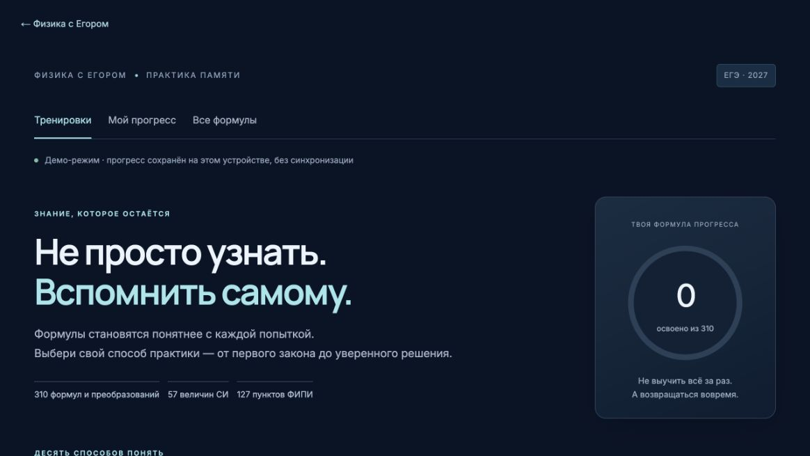
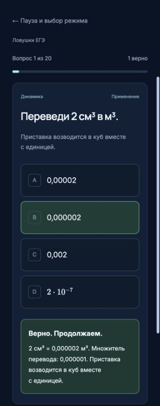

# Новый «Блиц»: результат реализации

Проверка завершена 19 ноября 2026 года. Ветка `feature/blitz-ege-complete`. Новый раздел не отправлялся на Render; рабочие данные и правила Firebase не изменялись.

## Реестр и источники

- 310 записей законов, применимых форм и производных преобразований; это не 310 независимых законов.
- 57 физических величин с единицами, выражениями через основные единицы, размерностями, типичными ошибками и связанными формулами.
- 34 качественных вопроса для содержания, которому не соответствует отдельная формула.
- 127 пунктов таблицы содержания ФИПИ-2027. Просмотрены печатные страницы 7–19 кодификатора и страница 4 справочных данных демоверсии.
- Контрольный список обязательных формул хранится отдельно от генерируемого каталога; сборщик отклоняет пропуски, неизвестные коды, величины и повторяющиеся идентификаторы.
- Источники: [официальная страница ФИПИ](https://fipi.ru/ege/demoversii-specifikacii-kodifikatory), [архив физики 2027](https://doc.fipi.ru/ege/demoversii-specifikacii-kodifikatory/2027/fi_11_2027.zip), [СИ BIPM](https://www.bipm.org/en/publications/si-brochure).
- Полная таблица соответствия, перечень формул, условия и ограничения — в [FORMULA_COVERAGE.md](../FORMULA_COVERAGE.md). Автоматически выявленных пробелов привязки — 0. Эта проверка не является независимой экспертизой физической корректности каждого выражения и не заменяет лабораторные навыки.

## Режимы и интерфейс

934 уникальных вопроса в общем реестре. Режимы используют пересекающиеся подборки, поэтому числа ниже нельзя складывать.

| Режим | Доступно без фильтров |
| --- | ---: |
| Классический блиц | 609 |
| Угадай формулу | 310 |
| Собери формулу | 300 |
| Найди неизвестную | 25 |
| Единицы СИ | 265 |
| Ловушки ЕГЭ | 83 |
| Флеш-карточки | 367 |
| Работа над ошибками | Зависит от собственных попыток |
| Экзамен по формулам | 609 |
| Формулы на время | 609 |

«Собери формулу» предлагает выбрать правую часть выражения из четырёх вариантов. Свободного символьного ввода и перетаскивания фрагментов в этом режиме нет. «Найди неизвестную» использует 25 явно подготовленных преобразований с проверенными вариантами ошибок.

Добавлены выбор нескольких разделов и тем, сложности, содержания и количества 10/20/30/50/100/все; реальное ограничение числа вопросов при малой выборке. В сессии нет повторяющихся идентификаторов вопросов. Форматы одного закона могут встречаться отдельно в тех режимах, где они допустимы.

Новый интерфейс: тёмный графитово-синий фон, светлая типографика, мягкий голубой акцент, крупные кнопки, состояния ответа, индикаторы прогресса, переворот карточек и учёт reduced-motion. KaTeX используется для формул, дробей, индексов, размерностей и научной записи чисел. Глобальная навигация сохранена; отдельный адрес — `/blitz`, также раздел встроен в существующий кабинет.

Статистика: изученные/освоенные/ожидающие повторения формулы, точность, серия дней, рекорд за 90 секунд, история, прогресс разделов, слабые формулы и темы. Для формулы сохраняются попытки, ошибки, точность, последнее и следующее повторение, уровень. Карточки явно обозначены как самооценка.

## Сохранение и исправление ошибки экзамена

Причина прежнего сообщения об ошибке: демо-экзамен пытался записать результат в Firestore без реального авторизованного пользователя.

- Ответы, активная сессия и завершённый результат нового блица сначала сохраняются транзакцией IndexedDB. Только после её успешного завершения меняется экран.
- Результаты разделены по UID, гостевому и демо-профилю. Демо-адрес `?demo=1` не отправляет результаты в Firebase.
- Завершённые попытки ставятся в локальную очередь; синхронизация выполняется для текущего реального аккаунта при входе, восстановлении сети, завершении попытки или ручном повторе.
- Используется существующая коллекция `examAttempts`. Правила не ослаблены. Стабильный ID позволяет повторять отправку без новых документов; при запрете повторной записи проверяется уже созданный собственный документ.
- Старый учебный вариант также сначала сохраняется в отдельную локальную очередь аккаунта, затем синхронизируется. Завершение по таймеру использует тот же путь. Подсчёт на экране согласован с существующим числовым валидатором, пустой ответ не считается нулём.
- История нового блица восстанавливается после перезагрузки и из результатов аккаунта. Очередь старого учебного варианта долговечная, но отдельного интерфейса просмотра её старых завершённых записей в этой работе не добавлено. Его прежний черновик в localStorage сохранён для совместимости.
- При запрете хранилища пользователь получает явное сообщение и повтор действия; приложение не сообщает об успешном сохранении до завершения транзакции. Очистка данных сайта самим пользователем удаляет локальные результаты.

## Проверки

Успешно выполнены:

- `npm test`: существующие проверки оценивания, кабинета, файлов, банка, формул, лаборатории, класса, безопасности, приглашений; проверка опубликованного банка 1460 заданий и 1687 изображений; новый набор блица.
- `npm run lint`: без ошибок и предупреждений линтера.
- `npm run build -- --webpack`: production build и TypeScript, 23 маршрута, включая `/blitz`.
- Новый набор проверяет ID/пустые данные/обязательные формулы, все LaTeX-выражения строгим KaTeX, 14 независимо заданных эталонных размерностей, критичные переводы единиц, десять режимов, фильтры, отсутствие повторов, сбалансированный экзамен, двойной ответ, таймер, интервальное повторение, восстановление состояния, локальную очередь, отсутствие сетевых обращений гостя, идемпотентные повторные отправки.
- В браузере: неверный ответ и разбор, восстановление после перезагрузки, повторение ошибки, карточка и самооценка; экзамен скрывает правильность до завершения; сборка выражения, неизвестная, СИ, ловушки, угадывание.
- Реальный таймер в браузере завершил попытку через 90 секунд и сохранил итог 1/20 с длительностью 90 секунд.
- Фильтр «Оптика / Угадай / 100» показал 18 доступных вопросов и запустил сессию из 18.
- Поиск в справочнике, раскрытие условия/обозначений/источника, статистика и история работают.
- Проверены фактические CSS-ширины окна 323, 354, 731 и 1163 px; ширина документа равна ширине окна. Ошибок KaTeX в проверенных экранах и ошибок консоли проверенной production-страницы не было.

Существующие информационные предупреждения Node о типе модулей в старых тестах и Next.js о внешнем package-lock не препятствуют проверкам; новых зависимостей нет.

## Что не проверено и не опубликовано

- Реальная запись и восстановление через production Firebase под аккаунтом ученика не выполнялись: рабочие данные запрещено менять в рамках ТЗ. Сетевой транспорт проверен с заменой внешнего I/O, существующие правила изучены; это не проверка живого сервиса.
- Нет испытания на физических iPhone/Android, повторной установки PWA, Safari/VoiceOver, Lighthouse и независимого экспертного рецензирования всех 934 вопросов.
- Банк PDF, его файлы и API не изменены. PWA, LiveKit, Cloudinary и авторизация не перенастраивались; регрессионные тесты прошли, но все сценарии этих интеграций вживую не повторялись.
- Push, слияние с публикуемой веткой и deploy новой версии требуют отдельного разрешения владельца. Эта ветка ещё не заменяет публичную версию сайта.

## Файлы

- `data/blitz/{formulas.tsv,quantities.tsv,concepts.tsv,codifier.json,catalog.json}` — исходные данные и каталог.
- `scripts/build-blitz-catalog.py`, `scripts/test-blitz.mjs`, `package.json` — генерация и проверки.
- `src/lib/blitz/{catalog,questions,engine,storage,sync,use-study}.ts` — модель, вопросы, повторение и сохранения.
- `src/components/BlitzTrainer.tsx`, `BlitzTrainer.module.css`, `BlitzPageClient.tsx` — интерфейс.
- `src/app/blitz/page.tsx`, `src/app/page.tsx`, `src/components/TypographyMotion.tsx` — маршрут, кабинет, совместимость оформления.
- `FORMULA_COVERAGE.md`, `docs/BLITZ-WORKLOG.md`, этот отчёт — результаты и источники.
- `docs/TRAINER-PUBLICATION.md` — отдельно зафиксирована успешная проверка ранее опубликованного PDF-банка.

## Скриншоты

