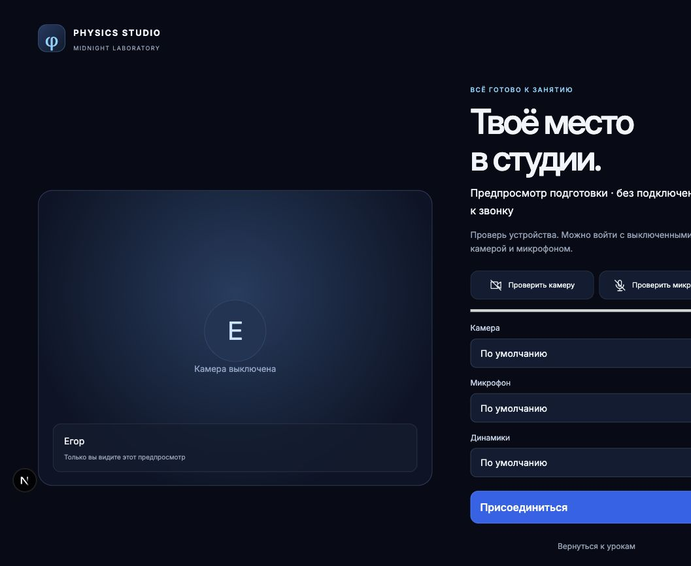
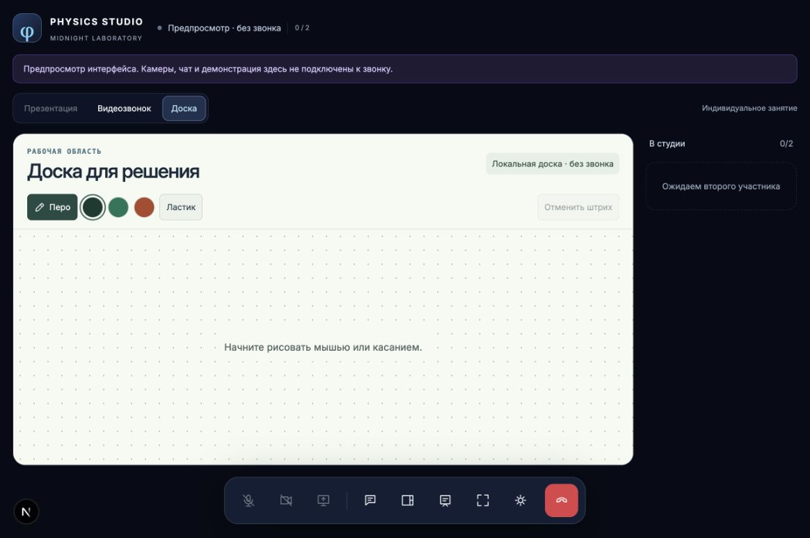
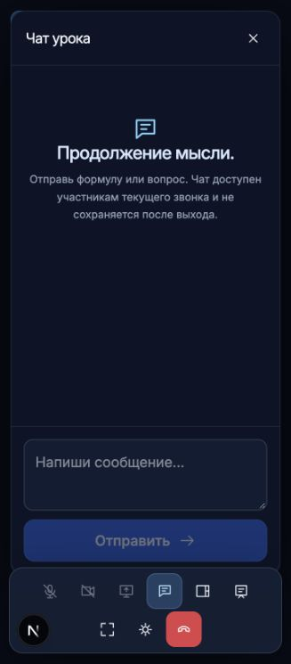

# PHYSICS STUDIO — рабочий журнал

19 ноября 2026. Ветка `feature/physics-studio`. Блиц опубликован: GitHub e00ec49, публичный /blitz принимает ответы и восстанавливает локальную историю после перезагрузки, ошибок консоли нет. Скриншот: screenshots/blitz-render-verified.png.

## Аудит и решение

Next.js 16 / React 19, Firebase Auth + Admin / Firestore, существующий LiveKit Cloud (клиент 2.23, серверный SDK), Render. Сервер уже выдаёт комнатные токены только связанным активным ученикам и преподавателю, ограничивает комнату двумя участниками, проверяет модерацию и синхронизирует доску. Отдельный гостевой сценарий использует секретные ссылки и флаг ENABLE_DEMO.

Сохраняем LiveKit: он уже обслуживает signaling, ICE, STUN/TURN, подписки и переподключение. Секреты остаются на сервере. Новых сервисов/платных зависимостей нет; звонки расходуют действующую квоту LiveKit, не обещается безлимитный бесплатный трафик. Render обслуживает страницу/API, не видеопоток. PowerPoint показывается только браузерным захватом окна/экрана, без управления PowerPoint. На мобильных захват может отсутствовать; просмотр поддерживается.

## Этапы

- A: аудит выполнен.
- B–E: общий интерфейс Studio/Cinema/Free, подготовка устройств, показ презентации, чат и настройки — реализация.
- F: проверки и отчёт после реализации. Реальная видеосвязь не объявляется проверенной по одному рисунку интерфейса.

Источники: https://docs.livekit.io/transport/media/screenshare/ ; https://docs.livekit.io/reference/client-sdk-js/interfaces/ScreenShareCaptureOptions.html ; локальные типы установленного LiveKit.

## Реализовано

- Общий `PhysicsStudio` для авторизованного и существующего гостевого урока, без дублирования интерфейса звонка.
- Midnight Laboratory: существующие локальные Manrope/Inter, тёмная палитра, SVG-иконки, плавающий док, состояния подключения, активного говорящего, слабой сети и выключенной камеры.
- Подготовка до подключения к LiveKit: локальный предпросмотр, микрофонный индикатор без вывода в динамики, выбор устройств, вход без камеры/микрофона. Захват начинается только нажатием кнопки. Отмена/выход останавливает дорожки. Ожидание разрешения ограничено 20 секундами; позднее разрешённый поток останавливается.
- Studio: контент и вертикальные камеры. Cinema: плавающие камеры, вход в fullscreen по действию пользователя, док скрывается при отсутствии взаимодействия, клавиатурный фокус возвращает управление. Free layout: камеры перемещаются мышью/касанием или стрелками; размер камер и панели регулируется; отдельные камеры скрываются. Нормализованные координаты удерживаются внутри рабочей области при изменении размеров; настройки сохраняются локально отдельно по аккаунтам, есть сброс.
- Презентация автоматически становится центральной областью при появлении screen-share track; при остановке восстанавливается выбранная область звонка/доски. `object-fit: contain` сохраняет края 16:9/4:3. Перед захватом предлагается выбирать окно показа слайдов, без управления PowerPoint. Используется детализация текста и ограничение частоты 15 fps / 4 Mbps; реальные разрешение/битрейт зависят от браузера и сети. Системный звук намеренно не запрашивается и не обещается.
- Чат по надёжным LiveKit data packets только внутри комнаты: имя от фактического участника, время приёма, текст до 1200 символов, фильтрация повреждённых пакетов, дедупликация, 200 сообщений в памяти, непрочитанные, прокрутка с учётом положения пользователя. React выводит текст без HTML. История после выхода и доставка участнику, подключившемуся позже, не обещаются. Загрузки файлов нет.
- Сервер выдаёт разрешение чата обоим участникам; screen share только преподавателю, включая гостевую комнату. Существующие серверные проверки учеников/уроков и лимит 2 участника сохранены. Добавлен ограниченный burst guard создания комнат (6 за 10 минут на преподавателя, 3 за 10 минут на адрес гостя). Он действует в одном процессе и не заменяет распределённую квоту/защиту от DDoS при масштабировании.
- Подписки, локальные камеры/микрофон/экран освобождаются при выходе, pagehide и отменённом асинхронном подключении. LiveKit выполняет ICE/signaling/TURN/reconnect; отдельная самописная WebRTC-инфраструктура не добавлена.
- Существующие общая доска, стирание/отмена, заметки и модерация сохранены. Контраст светлой доски внутри тёмной студии исправлен. Локальная доска без звонка остаётся доступна.
- Dialogs удерживают фокус, поддерживают Tab/Escape и возвращают фокус. Есть reduced-motion и safe-area. Безопасный адрес предпросмотра `/classroom?preview=studio` не создаёт комнату, не использует Firebase/LiveKit и явно обозначает отсутствие звонка.

## Проверки и ограничения

Успешно: production build `npm run build -- --webpack` с TypeScript; полный `npm test` (включая старый банк, 1460 опубликованных задач, блиц); `npm run lint`; `git diff --check`.

Новый `scripts/test-studio.mjs` проверяет границы/сохранение модели компоновки, недопустимые пакеты чата, burst guard; через настоящий LiveKit SDK подписывает и проверяет JWT преподавателя и ученика, chat grants, отсутствие screen-share у ученика, maxParticipants=2. API с заменённым внешним Firebase I/O отвергает постороннего, заблокированного/удалённого ученика, завершённую комнату, создание/завершение учеником. Отдельные проверки lifecycle медиа заменяют React/LiveKit I/O: отсутствие автоматического захвата при входе без устройств, освобождение на pagehide/cleanup, отмена pending connect, остановка поздно разрешённой камеры после timeout. Это автоматические проверки кода, а не реальный видеозвонок.

В браузере проверены: подготовка, сообщение о зависшем разрешении камеры и возможность продолжить без неё; Studio/Free/Cinema; сохранение Cinema после reload; чат/устройства/доска и отсутствие фиктивной отправки без звонка. Фактические ширины 290, 327 и 1163 px — горизонтальной прокрутки нет. При 1163 px контентная область доски около 893 px (около 79% области). Проверенная консоль без ошибок. Скриншоты ниже относятся к предпросмотру, а не к реальному звонку.

**Не проверено:** настоящий звонок между двумя сессиями, двусторонние камера/звук, захват PowerPoint, доставка чата через живой LiveKit, автоматическое восстановление реальной сети, физические iPhone/Android, системный выбор окна и смена аудиовыхода в разных браузерах. В локальной `.env.local` отсутствуют LiveKit URL/key/secret и Firebase Admin JSON. В доступном браузере запрос камеры остался без решения; проверен timeout, а не фактическая камера. Реальные production данные Firebase не изменялись, миграций и публикации студии не было. Поэтому критерии реального звонка из ТЗ пока не подтверждены.

## Следующий шаг — Render и приёмка звонка

Не передавать секреты в чат и не добавлять их в Git. На существующем Render-сервисе проверить переменные `LIVEKIT_URL` (`wss://...`), `LIVEKIT_API_KEY`, `LIVEKIT_API_SECRET`, `FIREBASE_SERVICE_ACCOUNT_JSON` и существующие `NEXT_PUBLIC_FIREBASE_*`. Значения не извлекались и не публиковались. Новые сервисы, домен, платный тариф, правила Firestore или миграция не требуются. Если сервер ещё не был настроен, без этих параметров реальный урок не заработает. Гостевые уроки зависят от существующего флага `NEXT_PUBLIC_ENABLE_DEMO`; для обычного аккаунтного урока он не нужен, включать его ради проверки не требуется.

После разрешённой публикации:

1. Преподаватель входит своим существующим аккаунтом, выбирает связанного активного ученика и создаёт урок. До кнопки «Присоединиться» видео не отправляется.
2. Ученик открывает приглашение в другом браузере/на втором устройстве под своим аккаунтом. Проверить отказ постороннему аккаунту.
3. Обе стороны проверяют камеру, микрофон и двусторонний звук, выключение/включение, выбор доступных устройств и подсветку говорящего.
4. Преподаватель открывает PowerPoint, выбирает **окно показа слайдов**, переключает реальные слайды. Ученик проверяет чёткость и все края в Studio/Cinema/Free, 16:9 и 4:3. Остановить показ системной кнопкой браузера и убедиться, что интерфейс вернулся в звонок.
5. Проверить сообщения в обе стороны, непрочитанные при закрытом чате и сохранение позиции прокрутки. Чат не должен воспринимать HTML как разметку.
6. Кратко прервать сеть и проверить восстановление; при окончательном разрыве использовать «Подключиться снова».
7. Завершить урок преподавателем. Убедиться, что ученик отключён, повторный вход закрыт, индикаторы камеры/микрофона браузера погасли. Для выхода только одного участника проверить возврат по прежней ссылке, пока урок открыт.

## Изменённые файлы

`src/components/PhysicsStudio.tsx`, `PhysicsStudio.module.css`, `StudioPrejoin.tsx`, `StudioDialog.tsx`, `StudioIcon.tsx`, `StudioPreview.tsx` — общий интерфейс и подготовка; `ClassroomEntry.tsx`, `ClassroomLesson.tsx`, `DemoClassroom.tsx` — интеграция; `src/lib/use-classroom-media.ts` — lifecycle и настройки; `src/lib/studio/{model,preview-media,creation-limit}.ts` — проверяемая модель, timeout, burst guard; `src/app/api/classroom/route.ts` и `demo/route.ts` — серверные grants; `src/app/classroom/page.tsx`, `src/components/TypographyMotion.tsx` — метаданные и совместимость; `scripts/test-studio.mjs`, `package.json` — проверки; этот отчёт и `docs/screenshots/studio-*.png` — результаты.

